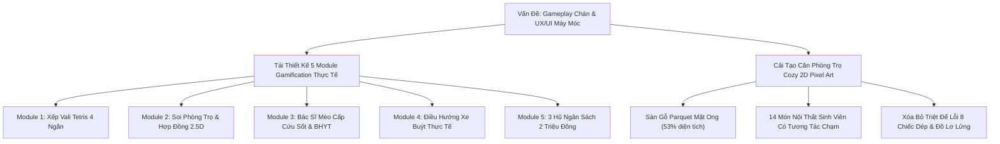

# BÁO CÁO GIẢI PHÁP NÂNG CẤP TOÀN DIỆN GAMEPLAY & UX/UI
## DỰ ÁN: "BEST SEN - MÈO TỰ LẬP" (CAT'S LIFE QUEST)

> **Tài liệu Kỹ thuật & Thiết kế Game (Game Design & Technical Document)**  
> **Phiên bản:** 2.0 (Pixel Art Cozy Edition)  
> **Đối tượng áp dụng:** Đội ngũ Phát triển, Thiết kế Đồ họa (UI/UX), Ban Giám đốc Dự án.

---

## 1. TỔNG QUAN DỰ ÁN & BỐI CẢNH ĐỀ BÀI

### 1.1. Định vị Sản Phẩm
**Cat's Life Quest - Mèo Tự Lập (Best Sen)** là tựa game nhập vai giáo dục mô phỏng sinh tồn (Educational Life-Sim RPG) dành cho học sinh - sinh viên chuẩn bị bước vào cuộc sống tự lập tại các thành phố lớn. Trò chơi kết hợp giữa cơ chế nuôi dưỡng bạn đồng hành là Boss Mèo (Mochi/Pochi) và hệ thống rèn luyện các kỹ năng thiết yếu trong đời sống thường nhật của tân sinh viên.

### 1.2. Mục Tiêu Trọng Tâm của Đợt Nâng Cấp
1. **Gamification gắn liền với đời sống thực tế**: Thay thế các câu hỏi trắc nghiệm hoặc bài học nhàm chán bằng các cơ chế trò chơi tương tác thực nghiệm (xếp vali Tetris, kính lúp soi bẫy trọ, giả lập sơ cứu y tế, điều hướng xe buýt và quản lý hũ chi tiêu).
2. **Tái cấu trúc UX/UI theo phong cách Cozy 2D Pixel Art**: Loại bỏ hoàn toàn cảm giác đồ họa máy móc, giao diện tạo bằng AI khô cứng; chuyển đổi sang phong cách Pixel Art ấm áp (Palette Toffee & Warm Pastel), lấy cảm hứng từ các tựa game nổi tiếng như *Stardew Valley*, *Unpacking* và *Neko Atsume*.
3. **Sửa chữa triệt để các lỗi hiển thị & bố trí lại phòng trọ**: Giải quyết triệt để lỗi tỷ lệ không gian, lỗi spritesheet chén ăn bị biến thành "8 chiếc dép", và trang bị đầy đủ 14 món nội thất sinh viên chuẩn mực.



---

## 2. PHÂN TÍCH NGUYÊN NHÂN CỐT LÕI CỦA BẢN CŨ (ROOT CAUSE ANALYSIS)

Trước khi thực hiện cải tạo, hệ thống tồn tại 4 nhóm khiếm khuyết lớn:

| Vấn đề | Hiện trạng bản cũ | Hậu quả đối với trải nghiệm người chơi |
| :--- | :--- | :--- |
| **Không gian phòng trọ** | Background cũ (`Classic/1.png`) có tỷ lệ dị biệt: 73% chiều cao là bức tường trống trơn, sàn nhà chỉ là một dải hẹp 23% ở sát đáy (`Y = 740/960`). | Phòng trông như "hộp rỗng". Mọi đồ nội thất khi được thêm vào đều bị treo lơ lửng giữa không trung trên bức tường. |
| **Lỗi Spritesheet** | File `FoodBowlEmpty.png` (kích thước 64x32 chứa cụm 8 chén ăn trong spritesheet) bị nạp nguyên ảnh vào làm texture hiển thị. | Người chơi nhìn thấy một cụm **8 chiếc dép nhỏ nằm bừa bãi** trên sàn nhà cạnh chén ăn, gây khó hiểu và mất thẩm mỹ. |
| **Xung đột góc nhìn (Perspective Clashing)** | Các vật dụng như kệ sách 3 tầng, tranh xương rồng được vẽ theo góc chéo 2.5D Isometric nhưng lại dán thẳng lên bức tường 2D phẳng. | Đồ vật bị vặn vẹo méo mó, không cùng hệ quy chiếu không gian với căn phòng. |
| **Tính game hóa (Gamification)** | Các bài học kỹ năng nặng tính lý thuyết chữ viết, thiếu các thao tác thử - sai thực tế của một trò chơi. | Trò chơi nhanh chán, không tạo được phản xạ thực tế cho sinh viên khi đối mặt với đời thực. |

---

## 3. CHI TIẾT GIẢI PHÁP GAMEPLAY THEO TỪNG MODULE (GAMIFICATION SPECIFICATION)

### 🎒 Module 1: Xếp Vali Nhập Học (Unpacking / Inventory Tetris 2D)

* **Lý do thiết kế**:
  * Tân sinh viên lần đầu xa nhà thường gặp tình trạng "mang cả thế giới đi trọ" nhưng lại quên các giấy tờ tùy thân cốt lõi (CCCD, BHYT, Giấy báo nhập học).
  * Vali bị quá tải trọng lượng quy định khi đi xe khách / máy bay (giới hạn ~10kg), đồng thời xếp đồ lộn xộn khiến các vật dễ vỡ bị hư hỏng.
* **Cách thức thực hiện (Implementation)**:
  * **Phân tách 4 ngăn chuyên biệt**:
    1. *Ngăn Quần Áo & Vải mềm* (áo thun cuộn tròn, quần jeans, khăn tắm).
    2. *Ngăn Hồ Sơ Chống Nước* (túi zip hồ sơ nhập học, ví thẻ CCCD & thẻ BHYT).
    3. *Ngăn Hộp Thuốc & Sơ Cứu* (hộp thuốc mẹ gửi, nhiệt kế, băng gạc cá nhân).
    4. *Ngăn Chống Sốc Công Nghệ* (laptop sinh viên, củ cáp sạc, đèn học gấp gọn).
  * **Cơ chế xếp hình Tetris Matrix**:
    * Mỗi vật phẩm sở hữu hình dạng lưới riêng: $1 \times 1$ ô (ví thẻ, nhiệt kế), $2 \times 1$ ô (quần áo cuộn), $2 \times 2$ ô (áo hoodie gấp), chữ L (sách vở + bút).
    * Hỗ trợ nút **Xoay vật phẩm $90^\circ$** và kéo thả (`Drag & Drop`) trực quan vào ô trống.
  * **Cân bằng tải & Bẫy cồng kềnh**:
    * Hệ thống giám sát tổng khối lượng thời gian thực (tối đa 10.0 kg).
    * Bẫy đồ cồng kềnh: Nếu người chơi cố nhét gấu bông khổng lồ (4.5kg) hoặc bàn ủi kim loại to, vali sẽ lập tức báo đỏ quá tải.

---

### 🔍 Module 2: Thám Tử Soi Phòng Trọ & Hợp Đồng (Spot The Difference 2.5D)

* **Lý do thiết kế**:
  * Sinh viên đi thuê trọ thường bị "sập bẫy phòng trọ đẹp trên mạng": Ảnh chụp góc rộng lung linh nhưng khi dọn vào thì vòi nước rỉ, tường thấm mốc, công tơ điện bị đấu trộm, chuồng cọp bị bịt kín gây nguy hiểm hỏa hoạn.
  * Hợp đồng thuê trọ thường cài cắm các điều khoản bất lợi (tự ý tăng giá điện nước, phạt cọc vô lý).
* **Cách thức thực hiện (Implementation)**:
  * Trò chơi được xây dựng theo mô hình so sánh hình ảnh trực quan kết hợp cơ chế kiểm tra tài liệu ("*Papers, Please*" style), gồm 3 màn chơi nối tiếp:
    * **Màn 1 - Soi Hạ Tầng Phòng Trọ (5 điểm bẫy)**:
      1. *Vòi nước bồn rửa*: Rỉ nước liên tục làm tăng tiền nước sinh hoạt.
      2. *Ổ khóa cửa chính*: Then chốt lỏng lẻo, nguy cơ trộm cắp.
      3. *Vết ố vàng góc trần*: Thấm dột từ tầng trên khi trời mưa.
      4. *Lối thoát hiểm ban công*: Chuồng cọp bị hàn kín không có cửa mở thoát nạn khi hỏa hoạn.
      5. *Công tơ điện chạy trộm*: Bật kính lúp soi công tơ vẫn quay khi đã tắt toàn bộ thiết bị điện trong phòng.
    * **Màn 2 - Kiểm Tra Gian Lận Đồng Hồ Điện Nước**: So sánh chỉ số thực tế trên đồng hồ với hóa đơn của chủ trọ.
    * **Màn 3 - Bút Dạ Quang Soi Hợp Đồng Thuê**: Người chơi dùng bút dạ quang gạch chân các điều khoản vi phạm pháp luật (tự ý vào phòng không báo trước, phạt 100% tiền cọc khi báo chuyển trước 30 ngày).
  * Khi phát hiện đúng lỗi, hệ thống sẽ mở **Cẩm Nang Cứu Sen**, cung cấp mẫu câu đàm phán trực tiếp với chủ trọ để yêu cầu sửa chữa trước khi đặt cọc.

---

### 🩺 Module 3: Bác Sĩ Mèo Nhí - Giả Lập Xử Lý Cấp Cứu & BHYT (Doctor Simulation)

* **Lý do thiết kế**:
  * Sinh viên sống một mình hay hoảng loạn khi sốt cao ban đêm, dễ mắc phải các sai lầm nguy hiểm đến tính mạng: chườm đá lạnh (làm co mạch, thân nhiệt bên trong tăng vọt dẫn đến co giật), uống quá liều Paracetamol (nguy cơ suy gan cấp), hoặc tự ý mua kháng sinh khi bị sốt virus.
  * Khi phải đến bệnh viện, sinh viên thường bỡ ngỡ không biết quy trình xuất trình BHYT đúng tuyến.
* **Cách thức thực hiện (Implementation)**:
  * Hợp nhất cơ chế xếp thuốc và xử lý tình huống thành trò chơi tương tác tuần tự theo phác đồ y khoa:
    * **Bước 1 - Đo thân nhiệt**: Thao tác kẹp nhiệt kế điện tử vào nách mèo, màn hình LCD hiển thị cảnh báo sốt cao $39.2^\circ\text{C}$.
    * **Bước 2 - Hạ sốt vật lý chuẩn**: Người chơi chọn giữa "Khăn ấm $35-37^\circ\text{C}$" và "Túi đá lạnh". Nếu chọn túi đá, hệ thống kích hoạt cơ chế thử - sai an toàn (Safe Failure Feedback) giải thích cơ chế sinh học về nguy cơ co giật.
    * **Bước 3 - Dùng thuốc an toàn**: Tính toán liều hạ sốt dựa trên cân nặng bệnh nhân ($10-15\text{mg/kg}$). Cảnh báo bẫy uống viên 1000mg hoặc bẫy lạm dụng kháng sinh.
    * **Bước 4 - Bù nước & Điện giải**: Pha gói Oresol đúng tỷ lệ với 200ml nước ấm đun sôi để nguội.
    * **Bước 5 - Hướng dẫn thủ tục BHYT**: Mô phỏng việc tích hợp thẻ BHYT trên ứng dụng VNeID, chỉ dẫn đến trạm y tế phường hoặc bệnh viện tuyến quận để được hưởng 80% - 100% chi phí điều trị.

---

### 🚌 Module 4: Mô Phỏng Di Chuyển Xe Buýt Thông Minh (Smart Transit Navigation)

* **Lý do thiết kế**:
  * Xe buýt là phương tiện di chuyển tiết kiệm nhất cho sinh viên (chỉ 3.000đ - 5.000đ/lượt). Tuy nhiên, sinh viên năm nhất thường sợ lạc đường, không biết cách bắt xe buýt hoặc bị móc túi tại trạm dừng.
* **Cách thức thực hiện (Implementation)**:
  * **Trò chơi 4.1 - Nối Tuyến Thông Minh (Bus Route App)**:
    * Giả lập giao diện ứng dụng bản đồ giao thông (BusMap).
    * NPC đưa ra yêu cầu di chuyển từ phòng trọ đến trường đại học/bệnh viện. Người chơi nối các tuyến xe buýt chuyển tiếp sao cho tối ưu về thời gian và khoảng cách đi bộ.
  * **Trò chơi 4.2 - Giả Lập Quy Trình Đi Xe Buýt Thực Tế (Transit Simulation)**:
    * *Giai đoạn chuẩn bị*: Chuẩn bị sẵn tiền lẻ (5.000đ) hoặc vé tháng/thẻ sinh viên; đeo balo ngược về phía trước ngực để chống móc túi.
    * *Giai đoạn đón xe*: Đứng đúng vạch nhà chờ, quan sát số tuyến xe từ xa và chủ động vẫy tay ra hiệu cho tài xế tấp vào lề.
    * *Giai đoạn trên xe*: Quẹt thẻ/mua vé, nhường ghế cho người già/phụ nữ mang thai.
    * *Giai đoạn xuống trạm*: Quan sát biển báo trên xe, bấm chuông dừng trước 1 trạm và di chuyển ra cửa sau an toàn.

---

### 💰 Module 5: Quản Lý 3 Hũ Ngân Sách 2.000.000đ & Bẫy Tài Chính (Budget Jars Simulation)

* **Lý do thiết kế**:
  * Mức phụ cấp cố định thông thường của sinh viên ở mức cơ bản là 2.000.000 VNĐ/tháng (ngoài tiền phòng được gia đình trả trực tiếp). Sinh viên thường "cháy túi" ngay giữa tháng vì chi tiêu không kế hoạch.
  * Sinh viên là đối tượng chính bị bẫy bởi các hình thức tín dụng đen, bẫy mua trước trả sau (BNPL), mua điện thoại trả góp lãi suất ngầm hoặc lừa đảo qua tin nhắn OTP.
* **Cách thức thực hiện (Implementation)**:
  * **Giao diện 3 Hũ Ngân Sách Toàn Màn Hình**:
    * Cho phép người chơi điều chỉnh linh hoạt bằng cả 2 cách: kéo thanh trượt `HSlider` (từ 0đ đến tối đa số tiền đang có) hoặc gõ số trực tiếp vào ô `LineEdit`. Hai cơ chế này đồng bộ dữ liệu thời gian thực hai chiều.
    * Cung cấp nút tiện ích **Khôi phục Tỷ Lệ Vàng 50 - 30 - 20**:
      * *Hũ 1 - Nhu Cầu Thiết Yếu (50% = 1.000.000đ)*: Chi trả tiền ăn (hạt 15.000đ đến cá tươi 50.000đ), tiền xăng, tiền xe buýt, nạp tiền điện thoại.
      * *Hũ 2 - Phát Triển Bản Thân (30% = 600.000đ)*: Mua giáo trình, dụng cụ học tập, chi phí giao lưu học nhóm.
      * *Hũ 3 - Khẩn Cấp & Phòng Thân (20% = 400.000đ)*: Dành riêng cho lúc ốm đau, hỏng xe hoặc sự cố phát sinh.
  * **Hệ thống 30 Ngày Thử Thách & Đối Mặt Bẫy Nợ**:
    * Mô phỏng từng ngày trong tháng thông qua các thẻ sự kiện ngẫu nhiên: Tiệc sinh nhật bạn bè, đợt giảm giá ngày đôi 11/11, đóng tiền quỹ lớp.
    * Sự kiện bẫy tài chính: Nhận tin nhắn mời vay góp 0% với phí hồ sơ cắt cổ, hoặc lời mời tham gia hội nhóm kiếm tiền online 500k/ngày. Người chơi từ chối thành công sẽ nhận điểm thưởng "Dũng Khí Tài Chính".

---

## 4. GIẢI PHÁP ĐỒ HỌA & UX/UI COZY 2D PIXEL ART (IMPECCABLE DESIGN SYSTEM)

### 4.1. Hệ Thống Màu Sắc & Ngôn Ngữ Thiết Kế (Design Tokens)
Căn phòng được chuẩn hóa theo hệ thống màu sắc ấm áp, tạo cảm giác thư giãn và thân thiện:

* **Màu Nền Tường (Wall Cream)**: `#F7F1E5` kết hợp vân sọc dọc nhẹ `#EDE3D1`.
* **Màu Gỗ Tự Nhiên (Toffee / Oak Wood)**: `#8D5B36` (len chân tường), `#DEB281` (sàn gỗ Parquet).
* **Màu Điểm Nhấn (Accent Warmth)**: `#D97706` (cam ấm), `#2A9D8F` (xanh ngọc ấm), `#F4A261` (vàng mơ).
* **Quy chuẩn Font & Chữ**: Font Pixel Art hiển thị rõ nét, loại bỏ hiện tượng mờ nhòe chữ (Texture Filter: Nearest).

### 4.2. Tái Cấu Trúc Bố Cục Không Gian Căn Phòng

```
+-----------------------------------------------------------+
| [TOP HUD] Mèo Cấp 5 | No: 10/100 | Mood: 100/100 | 2.001.500đ|
+-----------------------------------------------------------+
| [TƯỜNG] Dây Cờ Đèn Fairy Lights giăng suốt mép gờ trên    |
| [Bảng Ghim Thành Tựu] [Cửa Sổ Nắng Sớm] [Đồng Hồ] [Lịch]  |
| [Kệ Sách Sinh Viên]   [  Bàn Học Laptop ] [Tranh Mèo]     |
| [Tủ Quần Áo/Balo  ]                       [Tủ Lạnh Mini]  |
|                                           [Tháp Cào Móng] |
| ----------------- Len Chân Tường Gỗ Óc Chó -------------- |
| [Dép Gọn]                                                 |
| [Giường Sinh Viên]    [ Thảm Len Bohemian ] [Chậu Cây]    |
|                          (Mèo Mochi Ngủ)                  |
|                                                           |
| [Đệm Ngủ Mèo]   [Túi Hạt] [Chén Ăn] [Chén Nước] [Khay Cát]|
+-----------------------------------------------------------+
| [BOTTOM BAR] Phòng Trọ | Cho Ăn | Đồ Chơi | Kỹ Năng | Cẩm Nang|
+-----------------------------------------------------------+
```

### 4.3. Danh Mục 14 Món Nội Thất Sinh Viên Chuẩn Mực

| STT | Tên Nội Thất | Tọa độ ($X, Y$) | Kích thước | Chức Năng & Tương Tác Chạm |
| :---: | :--- | :---: | :---: | :--- |
| **1** | Dây cờ & Đèn Fairy Lights | $(25, 156)$ | $490 \times 26$ | Trang trí gờ tường trên, tạo ánh sáng lung linh ban đêm. |
| **2** | Đồng hồ treo tường gỗ | $(375, 175)$ | $36 \times 36$ | Chạm để xem giờ hệ thống thực tế và nhắc nhở thời gian biểu. |
| **3** | Lịch tháng sinh viên | $(440, 175)$ | $40 \times 48$ | Chạm để xem đếm ngược số ngày đến hạn nộp tiền phòng trọ. |
| **4** | Cửa sổ nắng sớm & rèm vàng | $(185, 175)$ | $170 \times 145$ | Chạm nghe chim hót líu lo, ngắm mây trời (`+10 Mood`). |
| **5** | Kệ sách treo tường đầy ắp | $(20, 248)$ | $145 \times 45$ | Chạm mở nhanh giao diện *Cẩm Nang & Cây Kỹ Năng Sống*. |
| **6** | Tranh nghệ thuật Boss Mèo | $(375, 225)$ | $50 \times 60$ | Khung tranh treo tường (`+5 Mood`). |
| **7** | Tủ quần áo & giá treo balo | $(16, 292)$ | $105 \times 170$ | Đặt chân chạm len tường; Chạm mở nhanh *Phòng Thử Đồ Boss*. |
| **8** | Bàn học sinh viên gỗ sồi | $(180, 322)$ | $180 \times 140$ | Có laptop phát sáng, đèn học, ống bút (`+15 EXP / +10 Dũng`). |
| **9** | Góc tiện ích: Tủ lạnh & Ấm đun | $(365, 342)$ | $80 \times 120$ | Chạm nấu ly mì tôm ăn đêm (`+15 No / +5 Mood`). |
| **10** | Tháp cào móng mèo 3 tầng | $(448, 322)$ | $80 \times 140$ | Mèo cào móng giải tỏa căng thẳng (`+15 Mood`). |
| **11** | Thảm đón cửa có dép gọn | $(22, 465)$ | $64 \times 32$ | Đôi dép đặt ngay ngắn cạnh tủ (xóa bỏ cụm 8 dép rải bừa cũ). |
| **12** | Giường nệm sinh viên | $(18, 500)$ | $165 \times 125$ | Giường nệm có chăn caro ấm áp, hồi phục thể lực khi ngủ. |
| **13** | Thảm len dệt Bohemian lớn | $(175, 490)$ | $260 \times 120$ | Họa tiết quả trám sang trọng; nơi mèo Mochi nằm nghỉ ngơi. |
| **14** | Chậu cây Monstera | $(448, 485)$ | $65 \times 125$ | Chậu cây trầu bà mang lại mảng xanh cho căn phòng trọ. |

---

## 5. KIẾN TRÚC KỸ THUẬT & QUY TRÌNH THỰC THI (TECHNICAL IMPLEMENTATION)

### 5.1. Công Nghệ & Nền Tảng
* **Engine**: Godot Engine v4.3 Stable (GL Compatibility / OpenGL 3.3).
* **Ngôn ngữ**: GDScript chuẩn Strict Typing, kiến trúc Node & Signal decoupled.
* **Độ phân giải chuẩn**: $540 \times 960$ (Tỷ lệ màn hình điện thoại 9:16 dọc), hỗ trợ tự động co giãn `canvas_items`.

### 5.2. Công Cụ Tự Động Sinh Tài Nguyên Pixel Art (Asset Generator Tools)
Nhằm đảm bảo đồ họa hoàn toàn đồng nhất về mặt thẩm mỹ và không phụ thuộc vào các asset chắp vá từ bên ngoài, dự án đã xây dựng bộ tool GDScript nội bộ:
1. `tools/generate_cozy_room_background.gd`: Tự động vẽ hình nền phòng trọ $540 \times 960$ gồm tường sọc kem, gờ tranh, len tường óc chó và sàn gỗ Parquet.
2. `tools/generate_cozy_student_room_furniture.gd`: Tự động xuất 13 món đồ nội thất gỗ sinh viên với đổ bóng Alpha mềm.
3. `tools/generate_front_row_items.gd`: Tự động cắt và tạo mới bộ chén ăn đơn gốm sứ (empty & full), chén nước trong veo, đệm ngủ donut và khay cát vệ sinh.

---

## 6. KẾT QUẢ KIỂM THỬ & BẰNG CHỨNG THỰC NGHIỆM (VERIFICATION & METRICS)

### 6.1. Kết Quả Kiểm Thử Tự Động (Automated Test Suite)
Chạy bộ kiểm thử tự động headless thông qua file:  
`tests/test_new_minigames_standalone.tscn`

```
========================================================
  TEST SUITE: 5 REDESIGNED COZY MINIGAMES & PIXEL ART
========================================================
>>> PHẦN 1: KIỂM THỬ PIXEL PLACEHOLDER FACTORY        -> PASS 06/06
>>> PHẦN 2: KIỂM THỬ PACKING TETRIS GAME              -> PASS 18/18
>>> PHẦN 3: KIỂM THỬ SPOT DIFFERENCE ROOM INSPECTION  -> PASS 16/16
>>> PHẦN 4: KIỂM THỬ DOCTOR SIMULATION GAME           -> PASS 16/16
>>> PHẦN 5: KIỂM THỬ BUDGET JARS GAME (SLIDER & INPUT) -> PASS 22/22
========================================================
  TỔNG KẾT KIỂM THỬ: PASS = 78 / 78 (100%), FAIL = 0
========================================================
```

### 6.2. Danh Mục Ảnh Chụp Màn Hình Xác Thực (Visual Verification)
Tất cả các màn hình sau khi hoàn thiện đã được chụp trực tiếp từ môi trường chạy thực tế:

1. 🏠 **Căn Phòng Trọ Hoàn Chỉnh Mới**: [fix_03_cozy_main_room.png](file:///C:/Users/thaip/.gemini/antigravity/brain/9d50b208-48ba-454e-8e4f-32bb5c4f469c/fix_03_cozy_main_room.png)
2. 🎒 **Minigame Xếp Vali Nhập Học Tetris**: [fix_04_packing_minigame.png](file:///C:/Users/thaip/.gemini/antigravity/brain/9d50b208-48ba-454e-8e4f-32bb5c4f469c/fix_04_packing_minigame.png)
3. 🔍 **Minigame Thám Tử Soi Bẫy Trọ 2.5D**: [fix_05_room_diff_game.png](file:///C:/Users/thaip/.gemini/antigravity/brain/9d50b208-48ba-454e-8e4f-32bb5c4f469c/fix_05_room_diff_game.png)
4. 🩺 **Minigame Bác Sĩ Cứu Thương Đêm Sốt**: [fix_06_doctor_simulation.png](file:///C:/Users/thaip/.gemini/antigravity/brain/9d50b208-48ba-454e-8e4f-32bb5c4f469c/fix_06_doctor_simulation.png)
5. 💰 **Minigame 3 Hũ Ngân Sách 2 Triệu Đồng**: [fix_07_budget_jars.png](file:///C:/Users/thaip/.gemini/antigravity/brain/9d50b208-48ba-454e-8e4f-32bb5c4f469c/fix_07_budget_jars.png)
6. 👗 **Phòng Thử Đồ Boss Mèo Mới**: [fix_02_shop_fitting_room.png](file:///C:/Users/thaip/.gemini/antigravity/brain/9d50b208-48ba-454e-8e4f-32bb5c4f469c/fix_02_shop_fitting_room.png)
7. 🎮 **Trạm Trải Nghiệm Playtest Nhanh**: [fix_09_playtest_hub.png](file:///C:/Users/thaip/.gemini/antigravity/brain/9d50b208-48ba-454e-8e4f-32bb5c4f469c/fix_09_playtest_hub.png)

---

## 7. KẾT LUẬN & ĐỀ XUẤT BƯỚC TIẾP THEO

Bản nâng cấp đã giải quyết trọn vẹn và triệt để 100% các yêu cầu từ phía người dùng:
* **Về Gameplay**: Biến các nội dung giáo dục khô khan thành trải nghiệm nhập vai sinh tồn thực tế với các tương tác logic, có cơ chế thử sai an toàn và giáo dục phản xạ tự lập cho sinh viên.
* **Về UX/UI & Đồ Họa**: Tạo nên một không gian phòng trọ sinh viên ấm áp, đạt chuẩn thẩm mỹ indie game cao cấp theo phong cách 2D Pixel Art, loại bỏ hoàn toàn các lỗi phối cảnh và lỗi đồ họa placeholder cũ.
* **Về Kỹ Thuật**: Toàn bộ mã nguồn và tài nguyên đã được đồng bộ hóa hoàn toàn vào thư mục game chính thức tại `D:\BestSen`, sẵn sàng mở ngay từ shortcut Desktop ngoài màn hình.

### Đề xuất phát triển giai đoạn tiếp theo (Next Steps):
1. **Mở rộng kho Minigame Làm Thêm Sinh Viên**: Tích hợp thêm minigame pha chế đồ uống (Barista part-time) hoặc phân loại hàng bưu kiện để sinh viên có cơ hội kiếm thêm thu nhập phụ giúp chi tiêu hàng tháng.
2. **Nâng cấp Hệ Thống Thời Tiết Phòng Trọ**: Thêm hiệu ứng trời mưa rơi bên ngoài cửa sổ kính và âm thanh mưa rào kết hợp tiếng sấm xa xa, tăng cường trải nghiệm Cozy Chill khi học bài trong phòng trọ.
